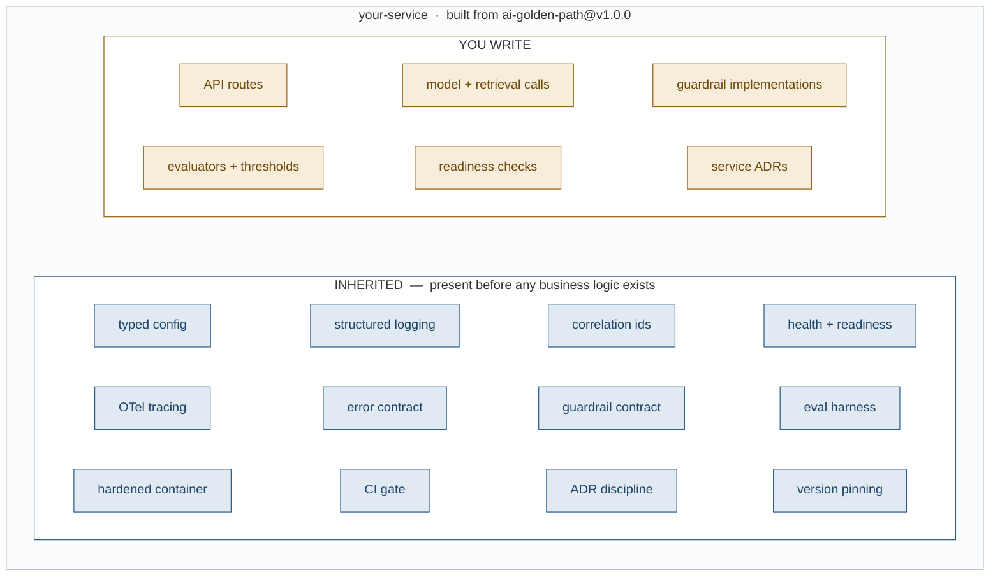

# ai-golden-path

**The paved road for AI services in a regulated enterprise.** Evaluation, tracing,
guardrail contracts and a CI gate are wired in *before* any business logic exists,
so a new service inherits its governance posture instead of retrofitting one.

It contains no AI. That is the point — see [What is deliberately not here](#what-is-deliberately-not-here).

---

## The problem this solves

An enterprise stands up its fifth AI use case and discovers it has five different
systems. Five retrieval implementations, five ways of logging, five error shapes,
five answers to "what does this cost per request" and five to "who approved this
model for this purpose." None of them can be governed as a group, because they
have nothing in common.

The usual response is a policy: a standards document, a checklist, a review board.
It fails predictably. Governance that depends on individual discipline is
abandoned the first time a deadline gets tight, and deadlines always get tight.

**A golden path takes the opposite approach: make the compliant path the easy
path.** A team that starts here gets structured logging, distributed tracing,
health probes, a container that passes a hardened runtime policy, a CI gate and
an evaluation harness — for free, on day one, without deciding to. A team that
goes its own way is free to, and simply does not get the support, the reviews,
or the pre-approved posture.

Mandates produce shadow implementations. Incentives produce adoption.

### What that looks like



Twelve of the eighteen boxes arrive for free. The team writes the six above the
line; everything below it — the entire security and observability posture — is
inherited the moment the repository is created.

Two more figures, for the support loop and the CI gate, are in
[docs/architecture.md](docs/architecture.md).

---

## The decisions

Every significant choice is recorded as an ADR with its **rejected alternatives**,
because the rejected alternative is what makes it a decision rather than a
description. These are the review artifacts an architecture board actually reads.

| # | Decision | Rejected | Why it matters at scale |
|---|---|---|---|
| [0001](docs/adr/0001-record-architecture-decisions.md) | Decisions recorded in-repo, immutable | A wiki; code comments; nothing | Teams stop re-litigating the same argument annually |
| [0002](docs/adr/0002-configuration-from-environment.md) | Typed, frozen config; unknown `APP_*` vars fail startup | `os.getenv`; per-env YAML; `extra="ignore"` | A typo'd deploy manifest fails in the pipeline, not at 3am |
| [0003](docs/adr/0003-structured-logging.md) | Correlation id stamped at `LogRecord` creation | Reading the ContextVar in the formatter; a handler filter; structlog | Survives `QueueHandler`. **We shipped the broken version first** — see [Bugs this caught](#bugs-this-caught) |
| [0004](docs/adr/0004-liveness-and-readiness-are-separate.md) | `/health` checks nothing; `/ready` checks dependencies | One endpoint that checks the database | Stops a slow dependency becoming a cluster-wide restart loop |
| [0005](docs/adr/0005-application-factory.md) | `create_app(settings)` factory | Module-level `app = FastAPI()` | Importing a module can never fail on a missing env var |
| [0006](docs/adr/0006-container-image.md) | Multi-stage, non-root fixed uid, pinned, exec-form entrypoint | Single stage; `latest` tags; shell form; Alpine | **0.7s graceful shutdown** instead of a 10s kill timeout, per pod, per deploy |
| [0007](docs/adr/0007-ci-pipeline.md) | Five jobs behind one required check | One job; five required checks; coverage without a floor | Nothing merges unformatted, untyped, untested, vulnerable or unbootable |
| [0008](docs/adr/0008-tracing.md) | Vendor-neutral OTLP; **two** ids, not one | A vendor SDK; trace id only; per-hop sampling | Changing observability vendors is a config change. A support ticket resolves to a trace |
| [0009](docs/adr/0009-error-contract.md) | RFC 9457 `problem+json`; no exception text in production | FastAPI defaults; a bespoke envelope; leaking exception text | Connection strings stop appearing in screenshots |
| [0010](docs/adr/0010-guardrail-interfaces-only.md) | Guardrail *contract* only; enforced at the model boundary | Shipping default guardrails; filtering the HTTP response body | Policy is per-service. Wrong defaults are worse than none, because people assume coverage |
| [0011](docs/adr/0011-evaluation-harness.md) | Content-hashed golden sets; mean **and** pass rate; absolute **and** regression checks | Version strings; reporting means only; unbounded concurrency | A quality regression fails a build instead of being discovered by a customer |

---

## Security posture

Concrete controls, not adjectives. Each is enforced by the template rather than
recommended by it.

**Runtime**

- Runs as a non-root user with a **fixed uid/gid (1001)**, so a Kubernetes
  `runAsUser` policy resolves rather than failing on an unresolvable name
- **Read-only root filesystem** with a tmpfs at `/tmp` and `no-new-privileges`.
  A change that starts writing to disk fails locally, not under production policy
- The runtime image contains **no package manager and no compiler** — the builder
  stage is discarded
- Base image and toolchain are **pinned**, never `latest`: the image shipped on
  Friday was built by the toolchain tested on Monday

**Data and error handling**

- **No exception text in production responses.** There is an explicit test
  asserting a fake credential does *not* appear in a 500 body, so a refactor that
  reintroduces the leak fails a test rather than an audit
- Interactive docs and the OpenAPI schema are **disabled in production**
- A guardrail rejection returns the guardrail *name* but never the *reason* — a
  detailed rejection message is a free oracle for probing the filter
- Logs carry no request bodies or headers by design; redaction is a guardrail
  concern, testable in isolation

**Supply chain**

- **Secret scanning across full git history**, run from the gitleaks image rather
  than the action, so it works identically under a personal account or an org
- **Dependency audit against the exported production lockfile**, not the installed
  environment — exactly what ships, excluding dev tooling. Currently 21 runtime
  dependencies, 0 known CVEs
- CI runs with `permissions: contents: read` at the top level; jobs escalate only
  if they must
- **The image is built in CI but never pushed.** Publishing is a release concern;
  a job holding registry credentials on every pull request is a far larger blast
  radius than one without them
- Dependabot tracks GitHub Actions, Python dependencies and base images weekly.
  ADR-0007 records when to escalate from tag pinning to commit-SHA pinning, and why

---

## Governance posture

**Proportionate, not maximal.** Governance that treats every use case as
high-risk gets routed around. Controls are keyed to risk tier.

- **Human-in-the-loop is tier-keyed**, not blanket. The agent harness contract
  supports approval gates that engage by risk classification
- **Guardrails are a first-class contract** (`Guardrail`, `GuardrailChain`) with
  redaction as well as blocking — a redacted response is still a response
- **Every guardrail result is returned**, not just the blocking one. Hit rates are
  an evaluation signal, not merely an operational one
- **The Production Quality Bar lives in configuration**, alongside the coverage
  floor, so the number developers see locally is the number CI enforces
- **Golden sets are identified by the hash of their contents.** Every eval run
  records it, and a baseline comparison across differing hashes is *refused* with
  a note rather than silently producing a confident wrong answer. This is the
  provenance trail behind any quality claim
- **Every request is reconstructable.** A user quotes a correlation id from an
  error screen; it finds the log line; the log line carries the trace id; the
  trace shows every hop

---

## How it scales

- **Adoption is by incentive.** The template is a GitHub template repository with
  semantic version tags, so a service pins a template version rather than
  "whatever `main` was that day"
- **Cost and latency attribution is built in**, per use case and per tenant, via
  OpenTelemetry. When services add model and retrieval spans, cost-per-request
  arrives through the same path with no new plumbing
- **Provider-agnostic by configuration.** No vendor is named in application code;
  the OTLP endpoint and model routing are settings
- **Bounded concurrency by default** in the eval harness, because the system under
  test is usually a rate-limited API and 200 simultaneous cases produce a report
  full of 429s that says nothing about quality
- **Readiness checks are registered, not hard-coded**, so a service declares its
  own dependencies without editing the template

---

## Evidence

Verified, not asserted. Every number below was produced by running the thing.

| | |
|---|---|
| Tests | 56 passing |
| Coverage | 96%, floor enforced at 70% in CI |
| Type checking | `mypy --strict` clean across 18 modules |
| Lint and format | `ruff` clean |
| Graceful shutdown | 0.7s (exec-form entrypoint, uvicorn as PID 1) |
| Runtime dependencies | 21, with 0 known CVEs |
| Architecture decisions | 11 ADRs, each with rejected alternatives |
| CI | Five jobs behind one required check; has rejected a non-conforming push |

### Bugs this caught

Included because how a system fails is more informative than how it succeeds.

**The access log recorded `-` for every correlation id.** The middleware logged
after a `try/finally` that reset the ContextVar. The response header was correct,
so a test checking only the header passed and the suite stayed green.

**Fixing that exposed the real bug.** The formatter read the ContextVar *at format
time*. That works today and breaks silently under a `QueueHandler` — the standard
way to keep logging off the request path — because formatting then happens on
another thread after the request has completed. Every correlation id would have
become `-` the day someone added one for performance.

The fix stamps the id onto each record at creation via `logging.setLogRecordFactory`.
Both the failure and the reasoning are recorded in
[ADR-0003](docs/adr/0003-structured-logging.md), along with the regression test.

---

## What is deliberately not here

Judgment about what to leave out is the harder half of a template.

- **Any AI code.** Retrieval, agents, prompts and model clients belong to services.
  The moment the template contains them, it stops being usable by the team
  building something different
- **Evaluation metrics.** The harness is here; the metrics are not. Groundedness
  belongs to a retrieval service, task success to an agent runtime.
  `python -m evals` exits non-zero until you write one — a service that wires the
  eval job into CI before writing an evaluator should not get a permanently green,
  permanently meaningless check
- **Guardrail implementations.** What counts as unacceptable input differs between
  a credit decisioning service and an internal documentation assistant. Shipping
  defaults would be wrong for both, and wrong defaults are worse than none
- **A response-body filter.** Guardrails attach at the *model call* boundary. By
  the time bytes reach an HTTP response you have lost which came from a model,
  which from retrieval, and which the service computed — and they need different
  treatment

---

## Quick start

```bash
uv sync --extra dev
cp .env.example .env
uv run uvicorn app.main:app --reload
```

```bash
curl -i localhost:8000/health     # liveness  — checks nothing, by design
curl -s localhost:8000/ready      # readiness — checks registered dependencies
```

In a container:

```bash
docker compose up --build
APP_HOST_PORT=8080 docker compose up    # if 8000 is taken
```

`uv run pytest` runs the suite with the coverage gate.
`uv run ruff check src tests` lints. `uv run mypy` type-checks.

## Building a service from this

1. **Use this template** on GitHub, and pin the template version you started from
2. Add routers under `src/app/api/v1/`
3. Register a readiness check for every dependency you cannot serve without:

```python
from app.api.health import register_readiness_check

async def check_vector_store() -> None:
    await client.ping()

register_readiness_check("vector_store", check_vector_store)
```

4. Implement your guardrails against the `Guardrail` contract and apply them
   around your model calls
5. Define your evaluators and your Production Quality Bar:

```python
from evals import Gate, Threshold, load_jsonl, run_eval

run = await run_eval(load_jsonl("evals/cases/golden.jsonl"), my_target, [Groundedness()])
gate = Gate(
    thresholds=(Threshold("groundedness", min_mean=0.85, min_pass_rate=0.95),),
    max_p95_latency_ms=2000,
)
result = gate.evaluate(run, baseline=last_accepted_run)
```

6. Write an ADR for anything the next person would otherwise have to guess at

---

## What you get

| | |
|---|---|
| **Config** | Typed, frozen, environment-sourced. Unknown `APP_*` vars fail startup. Production rejects DEBUG logging and console formatting |
| **Logging** | One JSON object per line to stdout, with service identity, correlation id, trace id and span id on every record. uvicorn's loggers folded in |
| **Correlation** | Accepted from `x-correlation-id` or `x-request-id`, generated when absent, echoed on the response, present in every error body |
| **Probes** | `/health` (liveness) and `/ready` (readiness, with a dependency registry) |
| **Tracing** | OpenTelemetry over OTLP, vendor-neutral, parent-based sampling, probes excluded. A no-op without a collector |
| **Errors** | RFC 9457 `problem+json` on every path, always carrying the correlation id |
| **Guardrails** | `Guardrail` / `GuardrailChain` contract supporting block and redact. No implementations |
| **Evaluation** | Harness, content-hashed golden sets, absolute and regression thresholds, text and JSON reports. No metrics |
| **Container** | Multi-stage, non-root, read-only, self-health-checking, exec-form entrypoint |
| **CI** | Lint, type check, coverage gate, dependency audit, secret scan, image build and live smoke test |
| **ADRs** | Eleven decisions, each with its rejected alternatives |
