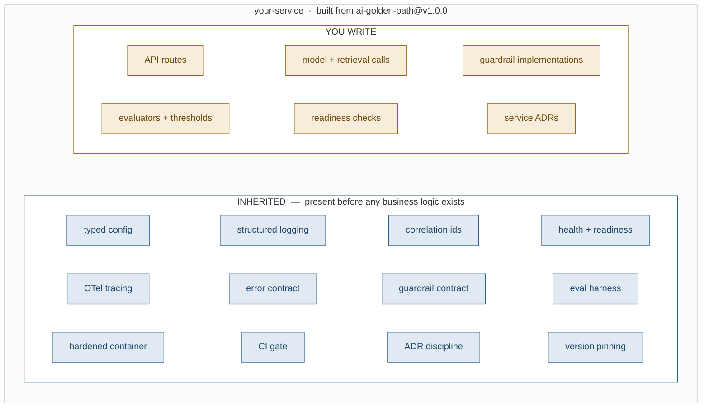
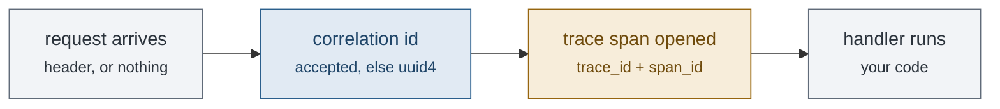
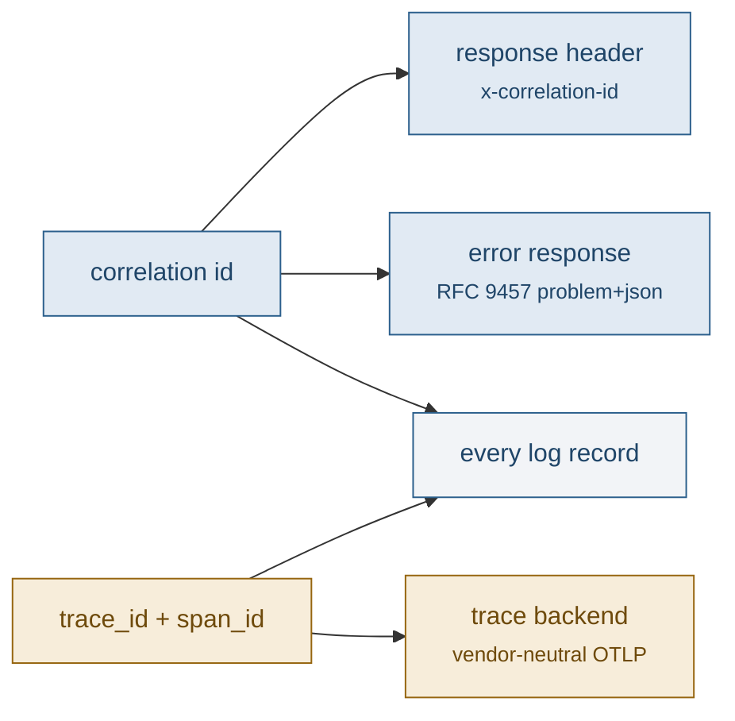
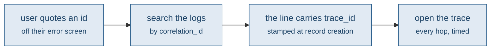
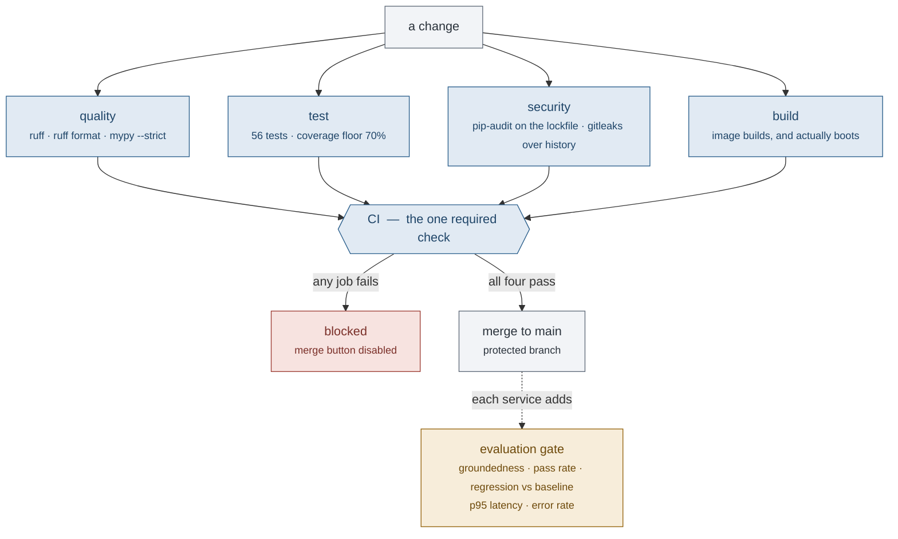

# Architecture

Three figures, each carrying one claim. A boundary, a loop, and a gate.

A single stack diagram of the components was deliberately not drawn: it would be
an inventory, and a reviewer who wants an inventory can read `ls src/app` faster.

---

## 1. The inheritance boundary

The central claim of a golden path is that governance arrives by default rather
than by discipline. That claim lives entirely in where this line falls.

**Twelve of the eighteen boxes arrive for free.** A team starting here writes
routes, model calls, guardrail implementations, evaluators, readiness checks and
its own ADRs. Everything else — including the entire security and observability
posture — is inherited the moment the repository is created.

Both planes reach code the team writes, not only code it inherits: a handler's
own log line carries the correlation id without the handler doing anything.

Nothing stops a team going around the template, and that is deliberate. The
paved road is made easier than the alternative rather than mandatory, because
mandates produce shadow implementations and incentives produce adoption.

Redraw this figure for each service built from the template. The ochre boxes
change; the blue ones never do. That repetition is the argument.

---

## 2. One request, two identifiers

Why the template carries both a correlation id and a trace id is the hardest
thing here to explain in prose.

Both identifiers are then stamped onto everything the request produces:

They answer different questions. The **correlation id** is business-facing and
quotable — accepted from the caller, echoed on the response, present in every
error body. The **trace id** is what an observability backend indexes on.

Carrying only one breaks the support loop:

A trace id alone breaks this at step one — nobody reads 32 hex characters off a
screen. A correlation id alone has no call graph behind it.

**"Stamped at record creation" is load-bearing.** Reading the context variable in
the formatter looks equivalent and fails silently under a `QueueHandler`, because
formatting then happens on another thread after the request has finished. We
shipped that bug and it is written up in
[ADR-0003](adr/0003-structured-logging.md), along with the regression test.

See also [ADR-0008](adr/0008-tracing.md) and [ADR-0009](adr/0009-error-contract.md).

---

## 3. What a change has to survive

"CI is a gate, not a report" is a sentence anyone can write. This is the version
that can be checked.

**Branch protection points at one aggregate check, not at four.** If all four
were listed as required and someone later added a fifth job, the protection rule
would silently stop covering it. One check that `needs` the rest cannot drift.

The template ships the evaluation harness and the thresholds contract. It ships
no metrics — groundedness belongs to a retrieval service, task success to an
agent runtime ([ADR-0011](adr/0011-evaluation-harness.md)).

This gate has rejected a push twice.

See [ADR-0007](adr/0007-ci-pipeline.md).
